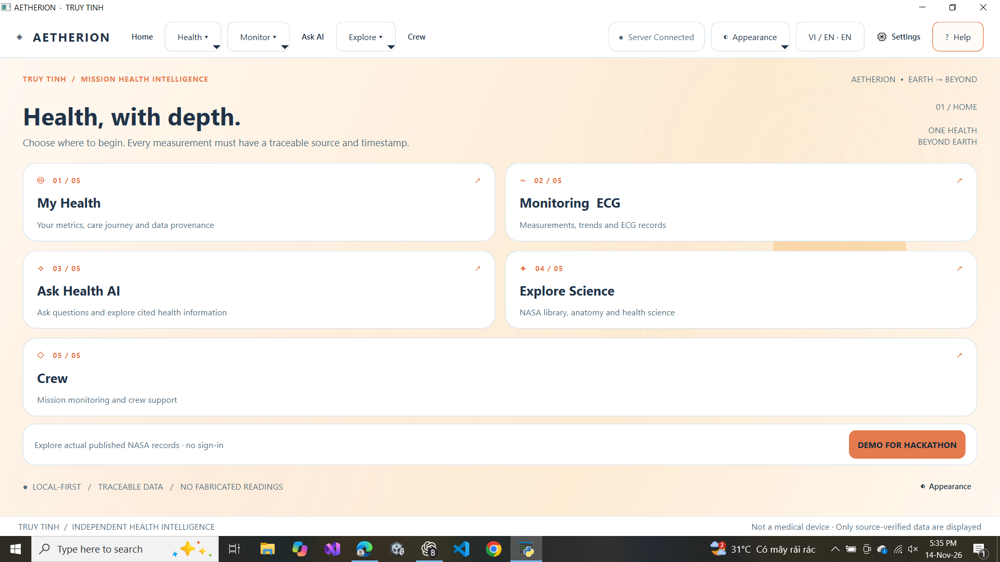

# AETHERION

### One Health. One Humanity. Beyond Earth.

AETHERION is an independent Team TRUY TINH project for the NASA Space Apps Challenge 2026. It connects a Python/FastAPI server, a native Python/Qt Windows desktop client, and an Expo/React Native mobile client into one local-first health journey.

[](https://github.com/huyng0699-arch/AETHERION/actions/workflows/android-demo-apk.yml)

## Download Android APK

**[Download the latest AETHERION Android release](https://github.com/huyng0699-arch/AETHERION/releases/latest)**

Each public release includes:

- `AETHERION-Android-Demo-v0.1.0.apk`
- `SHA256SUMS.txt`
- automated APK signature and ZIP-alignment verification
- the offline NASA Mercury-Atlas 7 historical archive

Package ID: `io.truytinh.aetherion.mobile`. Android SDK: 36.

## Windows desktop evidence

AETHERION has been launched successfully on Windows. This 1920×1080 capture shows the native application on its Portal screen with the Demo entry visible.



[Open the desktop runtime evidence](docs/evidence/aetherion-desktop-portal-20261114.png) · [Submission package](submission/README.md)

## Start the complete local system

On Windows, install Git, Python 3.11+, Node.js 22, JDK 17 and Android SDK 36, then run:

```powershell
git clone https://github.com/huyng0699-arch/AETHERION.git
cd AETHERION
py -3 -m venv .venv
.\.venv\Scripts\python.exe -m pip install --upgrade pip
.\.venv\Scripts\python.exe -m pip install -e "apps/server[admin]" -e apps/desktop
npm install --prefix apps/mobile --no-audit --no-fund
.\scripts\start_mobile_local.ps1
```

Open **http://127.0.0.1:8765/**. The first screen is Sign in with a visible **Demo** button. Demo opens the bundled NASA Mercury-Atlas 7 historical archive and works without an account or server connection. The launcher creates a private local owner account only when its database is empty; credentials are written to the Git-ignored `.runtime/local-access.json`.

See **[Getting started: Server, AI, Desktop and Android](docs/GETTING_STARTED.md)** for Server Control, Ollama/Gemini/OpenAI configuration, desktop launch, APK installation and Android build commands.

## System overview

- **Mobile:** Expo SDK 54 / React Native client for Android, iOS source compatibility and web export. The Android APK includes the NASA MA-7 archive for offline exploration. Authenticated health records, the server library and AI chat connect to AETHERION Server.
- **Server:** Python 3.11+ / FastAPI with SQLite, bearer sessions, access control, Admin Control and optional local or cloud AI providers. It defaults to the private loopback address `127.0.0.1`.
- **Desktop:** independent native PySide6 Windows client, not a browser wrapper and not the same binary as the Expo app.
- **NASA library:** a provenance-preserving catalog of 119 official condition names with 118 archived source records and separate source metadata.
- **AI:** administrator-controlled local Ollama or cloud Gemini/OpenAI routing. Deterministic application and safety behavior does not depend on an AI provider being enabled.

## Architecture and future devices

AETHERION uses one onboard Server as the authoritative coordination point. Desktop and mobile are separate clients of the same authenticated HTTP and data contracts. This design allows future adapters for watches, suits, habitat systems, rover consoles and spacecraft sensors without duplicating the health record or AI policy.

Expo/React Native shares application code across Android and iOS and can export a web client. iOS packaging requires macOS/Xcode and Apple signing. Windows uses the dedicated Python/Qt desktop client. Future watch, rover and spacecraft connections require their own tested hardware adapters, offline behavior, security controls and mission qualification.

## Project guidance

- [Getting started and operations](docs/GETTING_STARTED.md)
- [OnePad AI integration and provider boundaries](docs/AI_ONEPAD_INTEGRATION.md)
- [NASA catalog and archive audit](docs/NASA_CLIFF_119_ARCHIVE_AUDIT.md)
- [Third-party notices](THIRD_PARTY_NOTICES.md)

AETHERION is a research and demonstration project, not a NASA-endorsed product or a certified medical device. It must not be used for diagnosis or patient care. NASA and third-party materials remain subject to their recorded source and reuse terms.
