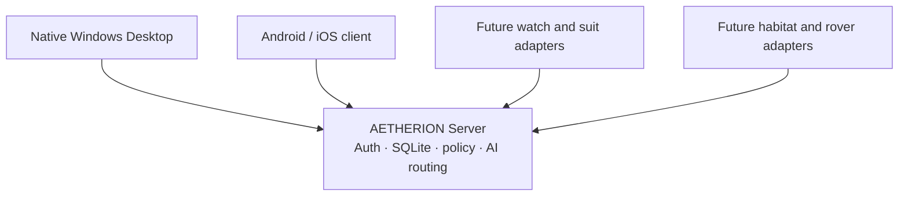

# AETHERION — installation, Server, AI, Desktop, Android and device roadmap

This is the public operations path for the AETHERION demonstration system. All commands below run from the repository root on Windows PowerShell unless stated otherwise.

## 1. Prerequisites

Install:

- Git
- Python 3.11 or newer
- Node.js 22
- JDK 17
- Android SDK Platform 36 and Build Tools 36.0.0 when building Android locally

```powershell
git clone https://github.com/huyng0699-arch/AETHERION.git
cd AETHERION
py -3 -m venv .venv
.\.venv\Scripts\python.exe -m pip install --upgrade pip
.\.venv\Scripts\python.exe -m pip install -e "apps/server[admin]" -e apps/desktop
npm install --prefix apps/mobile --no-audit --no-fund
```

## 2. Start the complete local system

```powershell
.\scripts\start_mobile_local.ps1
```

Open **http://127.0.0.1:8765/**. Check:

- health: **http://127.0.0.1:8765/health**
- readiness: **http://127.0.0.1:8765/ready**

Keep the terminal open. On an empty database the launcher creates a private local owner account and writes its credentials to `.runtime/local-access.json`. That file is excluded from Git.

### Start only the Server

```powershell
.\.venv\Scripts\python.exe -m uvicorn aetherion_server.main:app --host 127.0.0.1 --port 8765
```

AETHERION deliberately binds to loopback for the local demonstration. Do not open this development process directly to the public internet.

## 3. Server Control

With the Server running, open a second PowerShell window:

```powershell
$env:AETHERION_DB_PATH = (Join-Path $PWD '.runtime\local.sqlite3')
.\.venv\Scripts\python.exe -m aetherion_server.admin_gui
```

Sign in with the local owner account. Server Control provides user/access administration, Server status, AI provider configuration and SQLite backup. It must point to the same `http://127.0.0.1:8765` process; do not start a competing Server against the same database.

## 4. Configure AI

AI is an optional Server capability. The API key belongs on the Server, never inside the APK or Desktop client.

### Local AI with Ollama

Install and run Ollama on the same computer as AETHERION Server:

```powershell
ollama pull qwen2.5:3b
ollama list
```

In **Server Control → Local / Cloud AI**:

1. Choose Local AI.
2. Use `http://127.0.0.1:11434`.
3. Select the exact installed model.
4. Discover models, save settings and run the actual inference test.
5. Use Local mode in an authenticated client after the test succeeds.

### Gemini or OpenAI

1. In **Server Control → Local / Cloud AI**, choose Gemini or OpenAI.
2. Enter a model available to the provider account.
3. Paste the API key into the memory-only field.
4. Configure the provider and run a real request.
5. Use Cloud mode in the client with explicit user consent.

The Admin-entered cloud key stays in Server-process memory and is cleared when the Server restarts. A NASA data API key is not a Gemini/OpenAI model key. Provider routing details are in [AI OnePad integration](AI_ONEPAD_INTEGRATION.md).

## 5. Run the native Windows Desktop

```powershell
$env:AETHERION_API_URL = 'http://127.0.0.1:8765'
.\.venv\Scripts\python.exe -m aetherion_desktop
```

AETHERION Desktop is an independent native PySide6 client. It uses the same authenticated Server and SQLite record as Mobile; it is not a web page wrapped as a Windows application.

## 6. Install Android

Download the current public package:

**[AETHERION Android — latest GitHub Release](https://github.com/huyng0699-arch/AETHERION/releases/latest)**

The release contains the APK and `SHA256SUMS.txt`. Transfer the APK to Android, allow installation from the selected file source, install, and open AETHERION. The first-screen Demo opens the bundled NASA MA-7 historical archive offline.

### Build the release APK locally

```powershell
Push-Location apps/mobile
npm install --no-audit --no-fund
npm install --save-dev babel-preset-expo@54.0.12 --no-audit --no-fund
npx expo prebuild --platform android --no-install
Push-Location android
$env:NODE_ENV = 'production'
.\gradlew.bat --no-daemon --no-parallel --max-workers=1 -Pkotlin.compiler.execution.strategy=in-process assembleRelease
Pop-Location
Pop-Location
```

Output:

`apps/mobile/android/app/build/outputs/apk/release/app-release.apk`

GitHub Actions repeats the build from canonical source, verifies APK signature and ZIP alignment, calculates SHA-256, and publishes both APK and checksum to Releases.

### Connect an Android device during local development

The offline Demo needs no Server. Authenticated Server features can use:

- Android emulator: `http://10.0.2.2:8765`
- USB-connected device: run `adb reverse tcp:8765 tcp:8765`, then use `http://127.0.0.1:8765`

A remote device deployment needs an authenticated HTTPS gateway, device identity, certificate management and a security review; loopback development settings are not a public deployment design.

## 7. One architecture, multiple clients



The Server is the authoritative coordination point. Every observation carries subject, time, unit, source, scope, quality and verification metadata. Clients authenticate, submit or read permitted records, and show explicit offline/no-data/error states.

## 8. Future spacecraft-device path

Future hardware is connected through device-specific adapters rather than by putting hardware logic into the mobile UI:

1. **Adapter layer:** watch, suit, habitat, rover or medical-device protocol is translated into the AETHERION observation contract.
2. **Onboard edge Server:** identity, authorization, durable record, deterministic safety rules and optional local AI continue without Earth connectivity.
3. **Client layer:** Desktop, phone, tablet, watch and mission consoles display the same authorized record through interfaces appropriate to each device.
4. **Delayed synchronization:** signed, encrypted, conflict-aware exchanges synchronize with Earth when communications permit.
5. **Qualification:** each adapter receives hardware validation, calibration, cybersecurity, human-factors and mission-safety review before operational use.

This approach keeps the current Server–Desktop–Mobile system useful today while providing a controlled path to future lunar, Mars and spacecraft devices.

## 9. Platform map

| Target | Delivery path |
| --- | --- |
| Android | Published APK; Expo/React Native source |
| iOS/iPadOS | Shared Expo source; package on macOS/Xcode with Apple signing |
| Web | Expo web export |
| Windows | Separate native Python/Qt Desktop |
| Linux | Web client; a native package requires a separate verified build |
| Watch, suit, habitat, rover | Dedicated hardware adapter and client using the shared Server contract |

AETHERION is an independent research and demonstration project, not a NASA-endorsed product or certified medical device. Do not use it for diagnosis or patient care.
