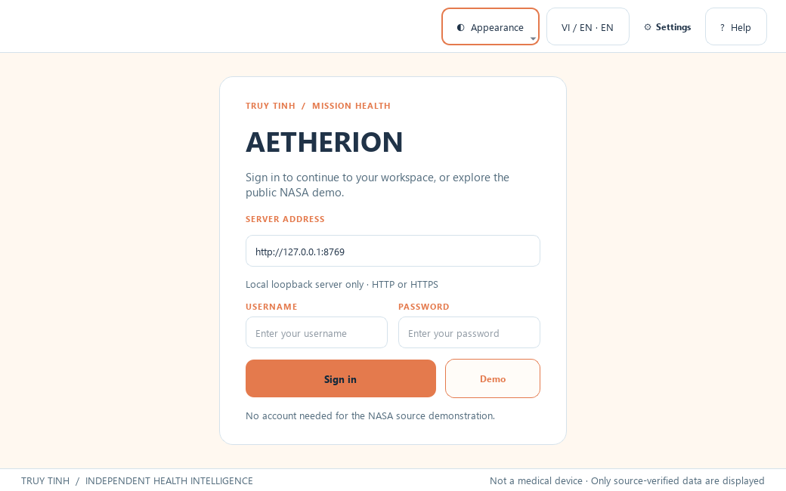
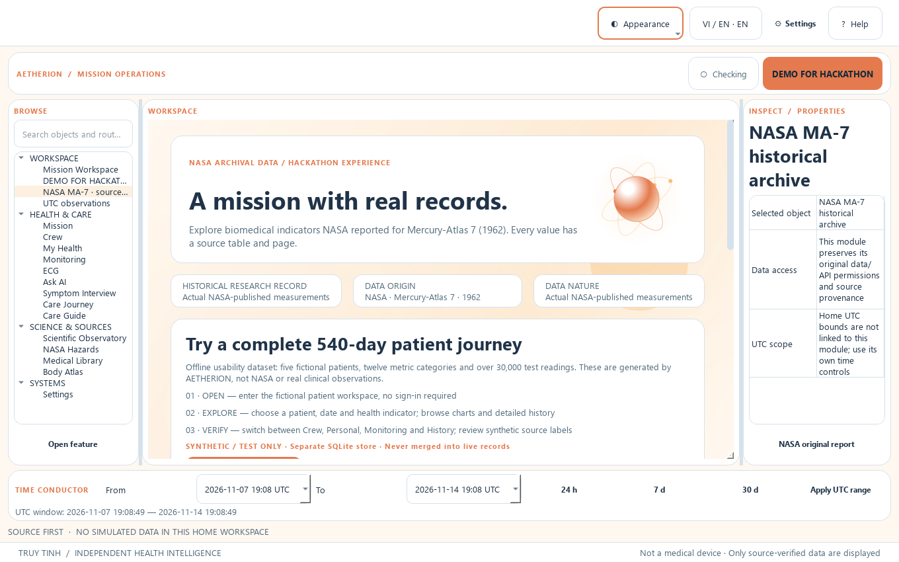

# AETHERION client/server delivery — 15 November 2026 (ICT)

The required entry on both clients is **Login with a visible Demo button**. Login Demo opens the NASA source briefing before the historical data. The native persistent workspace, existing synthetic-demo route and concurrent local-server startup helper are preserved; the synthetic fixture remains separate from current health records and from MA-7.

## Executed results

| Scope | Observed result | Evidence |
| --- | --- | --- |
| Live HTTP server, auth, readiness, schema, source delivery | 18/18 PASS | `docs/evidence/mobile-integration-api.json` |
| ACL, unauthorized writes, fixture separation, idempotency, pagination | 6/6 PASS | `docs/evidence/mobile-integration-acl.json` |
| Actual frontend HTTP adapters against that live server | 9/9 PASS | `docs/evidence/mobile-integration-client.json` |
| Captured login origin and logout on the normal runtime | 5/5 PASS | `docs/evidence/mobile-normal-auth-origin.json` |
| Executed navigation, server-URL policy and stale-bearer guard | 14/14 PASS | `docs/evidence/mobile-integration-state.json` |
| Delayed and failing native secure-storage adapter | 4/4 PASS | `docs/evidence/mobile-integration-storage.json` |
| Actual Qt window, Login, Demo introduction/data, real HTTP login/logout | 8/8 PASS, offscreen | `docs/evidence/mobile-integration-native.json` |
| Fresh dependency installation | `npm ci --offline` installed 658 packages successfully, including normal install scripts | Registry tarballs/integrity in mobile lockfile; no Solo path/link |
| TypeScript and Expo Web | PASS; 434 modules, 22 assets, web export | `npm run typecheck`, `npm run export:web` |
| Android JavaScript export | PASS; 707 modules, 22 assets | `npm run export:android:js`; debugging JS, not an APK |

**64/64 executed functional checks passed in the scopes above. This is not a 100% whole-product release certificate.** The frontend adapter check executes real API calls with in-memory web-storage adapters; the state check is not a browser rendering check. The delayed storage check runs the actual session module against an in-memory native adapter, not on a physical device. Native screenshots are Qt offscreen renders with the actual product stylesheet and registered Windows fonts, not a packaged EXE capture.

## Visual and device gates still open

- Headless Chromium launch was attempted and blocked by the execution environment: Chrome `spawn EPERM`; Edge failed Windows sandbox/IPC access. No new mobile browser screenshot or clickthrough is claimed. The earlier isolated preview is not evidence for the final login design.
- The 470px mobile canvas, font loading, persisted theme modes/presets and VI/EN are implemented and compile, but final web visual acceptance still requires a permitted browser run.
- Normal Hermes bytecode generation was blocked by `spawn EPERM`. The successful Android JS export does not prove a physical Android install, LAN/TLS pairing or release APK.
- No AI provider/model is enabled by the launcher. Status and unavailable/error behavior are verified; no model-generated completion is claimed.
- CLIFF-119 is absent. The 118 source JSON records, 5 hazards and 819-label vocabulary were copied from the existing AETHERION commit with matching Git blob hashes. `original_pdf_archive_verified=false` and `clinical_rules_validated=false` remain unchanged.

## Runtime and data boundaries

- One local FastAPI process serves the web export and HTTP API at `http://127.0.0.1:8765/`. No CORS proxy is required for this entry.
- Normal use: `.runtime/local.sqlite3`, private random owner credentials in `.runtime/local-access.json`.
- Verification: `.runtime/verification.sqlite3`, separate generated test credentials and explicitly classified test fixtures.
- Normal and verification launchers default to ports 8765 and 8769, respectively. A running listener associated with the other database is rejected.
- A session is bound to its server origin. URL changes reset navigation to Login. Logout clears local storage before revoking the captured token at its original server.
- Wildcard access resolves to registered authorized subjects; `*` cannot be registered as a patient ID. Older responses, unmounted-screen completions and duplicate write taps are guarded.

## Native evidence

Source checkpoint: `98e92f59aca19e0712d1c6e0fb9bba70405ad2d2`, including reconciliation of 20 intervening commits. This delivery also preserves subsequent changes on main and includes launcher, captured-origin, secure-storage ordering and request-gate repairs. Normal-runtime smoke evidence is in `docs/evidence/mobile-normal-runtime.json`; it confirms Admin access, zero test profiles and a matching web export. No Quest was marked DONE by this delivery.
