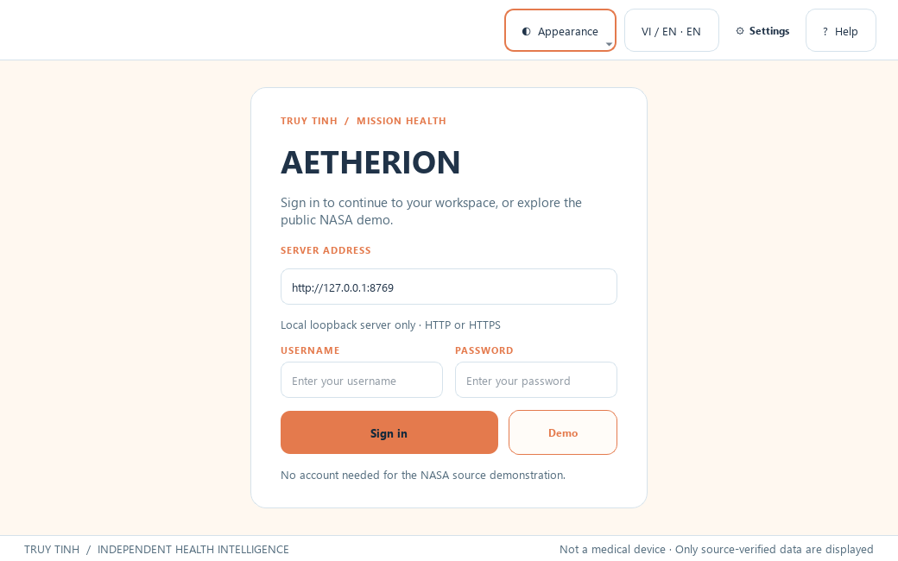
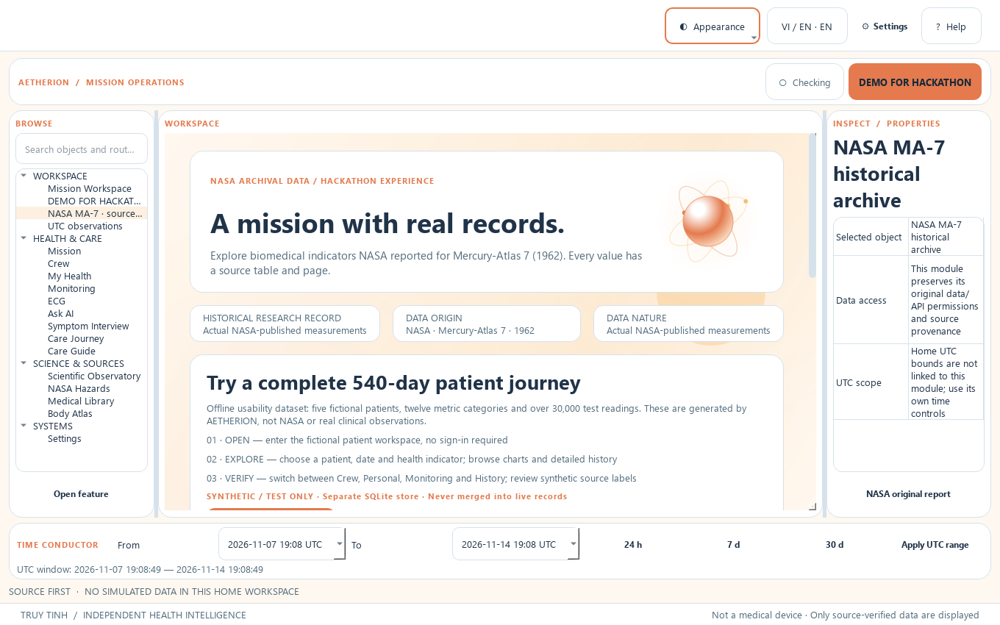
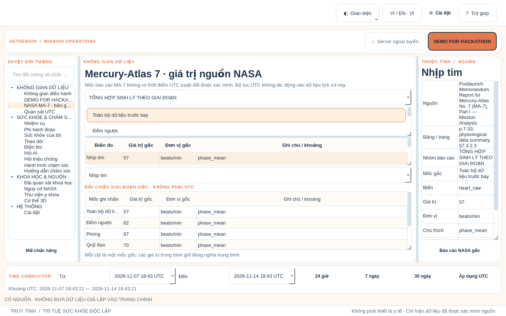
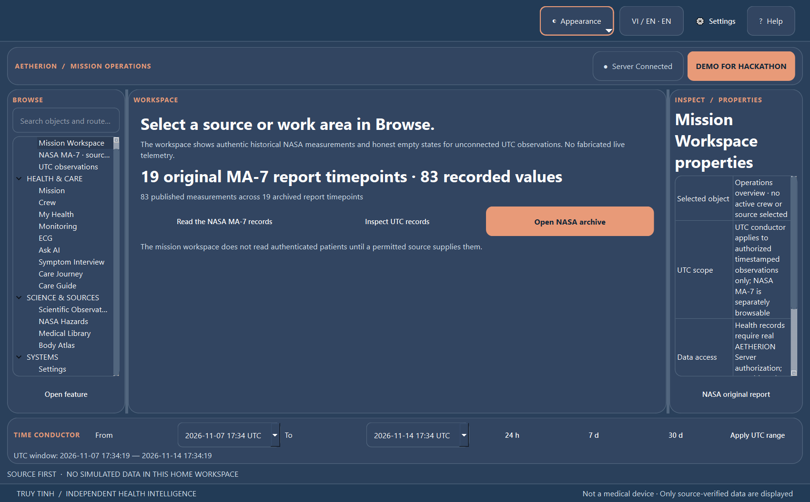
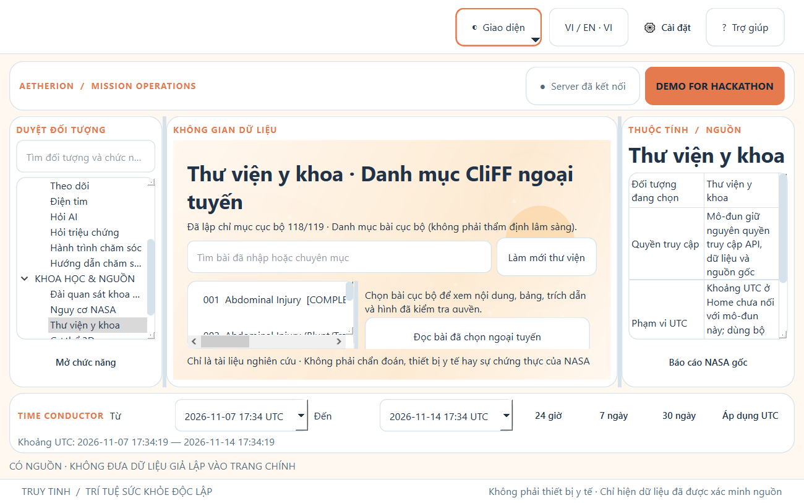

# AETHERION — NASA Demo Plan

**Project:** TRUY TINH · NASA Space Apps Challenge 2026  
**Source checkpoint:** `8406b97941d6651a899cf75b196be69f8518b4b1`  
**Demo duration:** 30 seconds

## 30-second route

| Time | Screen or action | Presenter line |
|---|---|---|
| 0–4 s | Login → select **Demo** | “The public Demo starts without an account.” |
| 4–9 s | NASA MA-7 briefing | “It opens bundled historical NASA records without the server.” |
| 9–21 s | Open the archive, choose a metric and original report phase | “Each value keeps its unit, qualifier, and source context.” |
| 21–26 s | Show the Inspector and NASA report link | “This is the 1962 Mercury–Atlas 7 report, not live telemetry.” |
| 26–30 s | State the boundary | “Private health records and AI require the authorized server.” |

### 30-second voice-over

> AETHERION by TRUY TINH is an early astronaut-health research prototype with a native desktop client and an Expo mobile client connected to one Python server. Its no-login Demo opens bundled historical Mercury–Atlas 7 measurements without a server. Viewers can inspect reported values, units, flight phases, and source pages. These are archival research data, not live telemetry. Personal records and AI require an authorized, configured server. AETHERION is not a medical device or a NASA-endorsed system.

## App locations

| Component | Repository path | Role |
|---|---|---|
| Server | `apps/server/` | Python/FastAPI, SQLite, authorization, Admin, optional AI |
| Desktop | `apps/desktop/` | Native PySide6 mission-health client |
| Phone and web | `apps/mobile/` | Expo / React Native; Android and iOS source; Expo Web export |

The Demo reads the bundled MA-7 archive and works without sign-in or a server. The server defaults to loopback; do not expose the prototype API, Admin, patient records, or AI keys through a public tunnel.

## Real UI evidence

These are unaltered screenshots already recorded in repository QA evidence. Each description names its actual capture method and limits; they are not AI-generated mockups.

### 1. Sign in and public Demo

English Login capture at 1040 px. Source: native Qt offscreen render; it is not a packaged EXE screenshot.

### 2. NASA MA-7 briefing

The right Inspector identifies the selected NASA MA-7 historical archive. The center separates the source briefing from fictional test data. Source: native Qt offscreen render; it is not a packaged EXE screenshot.

### 3. NASA measurement table

Vietnamese-locale Qt render. Example: heart rate 57 beats/min, qualifier `phase_mean`. Read the value and source metadata; do not assign invented UTC timestamps. This is not a packaged EXE clickthrough.

### 4. Mission workspace

English dark-theme Windows Qt widget capture. The NASA archive and authorized UTC workspace remain separate. This is not a packaged EXE clickthrough.

### 5. Medical library

Light-theme Windows Qt widget capture. The catalog lists 119 condition names and currently includes 118 source JSON records; this is not a completed 119-document archive or clinical validation.

## NASA data and claim boundaries

- The numerical demo uses the supplemental NASA archival report *Postlaunch Memorandum Report for Mercury-Atlas No. 7 (MA-7), Part I — Mission Analysis* (15 June 1962). [NASA source PDF](https://www.nasa.gov/wp-content/uploads/2026/01/ma07-te2.pdf)
- Current source records contain 19 report timepoints, 18 metrics, and 83 reported values. Original phases, units, qualifiers, and report provenance are preserved. The data are historical—not live telemetry.
- Do not claim live ECG, SpO₂, sleep, mood, radiation-dose, or crew sensor data. Do not claim clinical validation or NASA endorsement.
- AI is disabled until an administrator configures a provider and confirms an actual inference. This demo does not show live AI.
- The current Android/iOS UI is not represented by these desktop screenshots. Do not label desktop images as phone captures. Capture a real Expo screen on a device or with the repository's Expo screenshot workflow before presenting the phone client visually.
