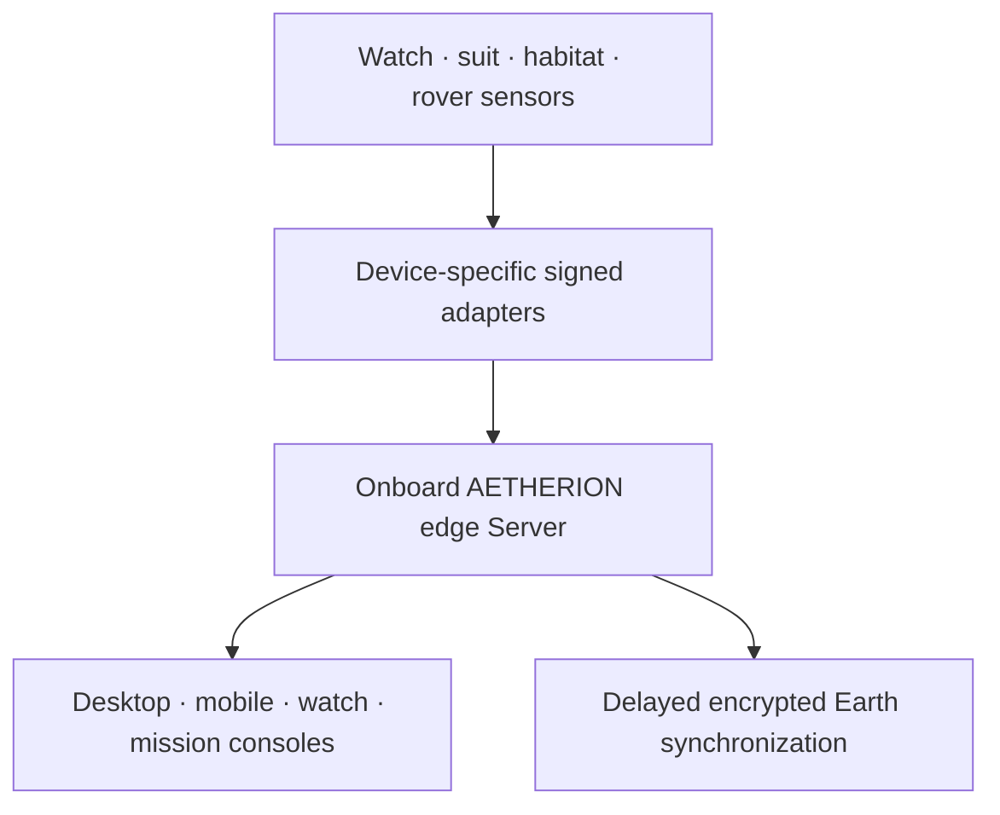

# AETHERION operations and device integration contract

Use [Getting Started](GETTING_STARTED.md) for installation and commands. This document defines how the working Server, AI, Desktop and Mobile components fit together and how future spacecraft devices join the same system.

## Runtime ownership

| Component | Responsibility | Trust boundary |
| --- | --- | --- |
| AETHERION Server | authentication, authorization, SQLite record, readiness, policy and AI routing | authoritative local process |
| Server Control | administrator accounts, access, backup and AI configuration | administrator only |
| Windows Desktop | native mission/health workspace | authenticated Server client |
| Android/iOS/Web | portable user experience and offline NASA archive | authenticated Server client when connected |
| AI provider | optional local Ollama or consented cloud inference | never the source of authorization or record identity |
| Device adapter | translate a specific sensor/device protocol | scoped device identity and permissions |

There is one Server and one authoritative observation store. Clients do not create competing databases for the same operational record.

## Operational sequence

1. Start the Server and require `/health` and `/ready`.
2. Open Server Control against the same URL and database.
3. Provision user and device access.
4. Configure and test an AI provider only if required.
5. Start Desktop and/or Mobile with the Server URL.
6. Confirm authentication, source identity and read/write scope.
7. Use the offline NASA Demo independently of protected operational records.
8. Back up SQLite through Server Control before material configuration changes.

## AI routing

Deterministic application behavior, access control and safety policy remain in AETHERION. AI is optional.

- **Local:** Server calls Ollama on its own host.
- **Cloud:** Server calls the selected Gemini or OpenAI endpoint only after administrator configuration and user consent.
- **Secrets:** keys stay on the Server side; Mobile and Desktop never receive them.
- **Failure:** a missing or failed provider returns unavailable/error state; AETHERION does not manufacture a substitute model response.
- **Records:** model output is not silently converted into a verified health observation.

## Observation envelope

Every future device adapter should produce the same minimum metadata:

| Field | Meaning |
| --- | --- |
| `subject_id` | authorized person/crew identity |
| `metric` | stable machine-readable measurement name |
| `value` and `unit` | measurement and explicit unit |
| `observed_at` | timezone-aware acquisition time |
| `source_id` | exact device, archive or user source |
| `scope` | operational purpose and access boundary |
| `quality` | READY, NO_DATA, STALE, OFFLINE, DENIED, ERROR or UNVERIFIED |
| `verification` | calibration/review state and provenance |

No signal is treated as live merely because a client displays it. Missing data is not evidence of a clinical event.

## Spacecraft integration layers

### Layer 1 — device adapter

Each hardware family gets an independently tested adapter for transport, timestamps, units, calibration, quality state, reconnect behavior and device identity.

### Layer 2 — onboard edge Server

The edge Server keeps local authentication, durable records, deterministic safety rules and optional local AI available during communications delay or outage.

### Layer 3 — human interfaces

Desktop, mobile, watch and mission-console clients render the same authorized record using form factors appropriate to their operators. They do not redefine the observation contract.

### Layer 4 — delayed Earth synchronization

Synchronization must be signed, encrypted, resumable and conflict-aware. Earth loss does not disable onboard care records. Reconnection does not overwrite a newer onboard observation silently.

## Integration gates for a new device

A device is connected only after:

1. protocol and license review;
2. device identity and least-privilege scope;
3. timestamp, unit and calibration validation;
4. offline buffering and reconnect test;
5. duplicate/conflict handling;
6. cybersecurity and privacy review;
7. human-factors review;
8. hardware and mission-environment verification.

The current Android release demonstrates the client architecture. Watch, suit, habitat, rover and flight integrations follow this contract but require their own hardware evidence and qualification.
