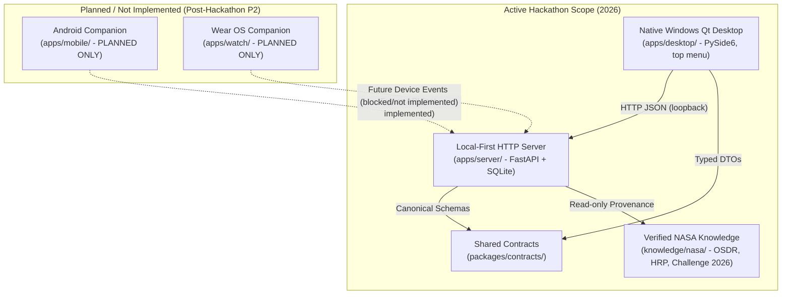

# AETHERION — Submission Architecture Diagram (Q-0261)

This diagram depicts the **actual implemented & active-hackathon boundaries** of AETHERION, separating the local-first HTTP server, the native Windows PySide6/Qt desktop application, and **planned (not yet implemented)** future companions.

## Component Reality Check

| Component | Path | Status | Notes |
| --- | --- | --- | --- |
| Local HTTP Server | `apps/server/` | Active Hackathon (`P0`) | Separate FastAPI process with SQLite persistence & provenance |
| Native Windows Desktop | `apps/desktop/` | Active Hackathon (`P0`) | Standalone PySide6/Qt app (not a browser/WebEngine wrapper) |
| Shared Contracts | `packages/contracts/` | Active Hackathon (`P0`) | Single canonical schema source |
| NASA Reference Library | `knowledge/nasa/` | Verified Metadata (`P0/P1`) | OSDR/HRP/2026 challenge metadata (`not_live_crew_telemetry`); CliFF 119 `0/119 NOT_IMPORTED` |
| Android Companion | `apps/mobile/` | **PLANNED ONLY** | `README.md` only; no implemented mobile app |
| Wear OS Companion | `apps/watch/` | **PLANNED ONLY** | `README.md` only; Scenario F remains blocked/future |
