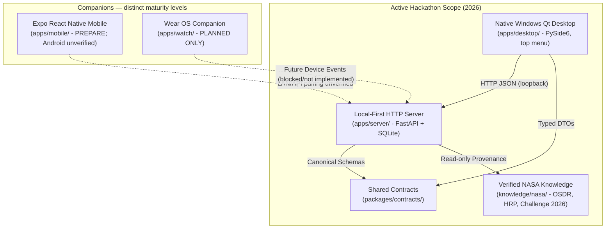

# AETHERION — Submission Architecture Diagram (Q-0261)

This diagram depicts the **actual implemented & active-hackathon boundaries** of AETHERION, separating the local-first HTTP server, the native Windows PySide6/Qt desktop application, an **implemented Expo mobile prototype (PREPARE)**, and a **planned Wear OS companion**. This is a source-code inventory, not Android hardware or release certification.

## Component Reality Check

| Component | Path | Status | Notes |
| --- | --- | --- | --- |
| Local HTTP Server | `apps/server/` | Active Hackathon (`P0`) | Separate FastAPI process with SQLite persistence & provenance |
| Native Windows Desktop | `apps/desktop/` | Active Hackathon (`P0`) | Standalone PySide6/Qt app (not a browser/WebEngine wrapper) |
| Shared Contracts | `packages/contracts/` | Active Hackathon (`P0`) | Single canonical schema source |
| NASA Reference Library | `knowledge/nasa/` | Verified Metadata (`P0/P1`) | OSDR/HRP/2026 challenge metadata (`not_live_crew_telemetry`); CliFF 119 `118/119` packaged offline at coordinator audit baseline (2026-11-14); missing final original and Windows reader acceptance |
| Android Companion | `apps/mobile/` | **PREPARE — Expo source exists** | React Native/TypeScript source present; `npm ci --dry-run` lockfile mismatch at 2026-11-14 audit; Android device, LAN pairing, HTTPS and release **unverified** |
| Wear OS Companion | `apps/watch/` | **PLANNED ONLY** | `README.md` only; Scenario F remains blocked/future |

## Evidence boundary (2026-11-14)

The server is the canonical HTTP + SQLite authority; the native Qt desktop is a separate process. The Expo source is an **in-progress companion**, not a deployed Android app, and Wear OS remains **PLANNED ONLY**. CliFF `118/119` is a coordinator-reported Linux offline packaging result, not a Windows validation or a claim that the unresolved 119th NASA original exists. NASA historical sources are not live telemetry. No Project-tab submission, flight/clinical certification, mobile device pairing, or public release is asserted by this diagram.
