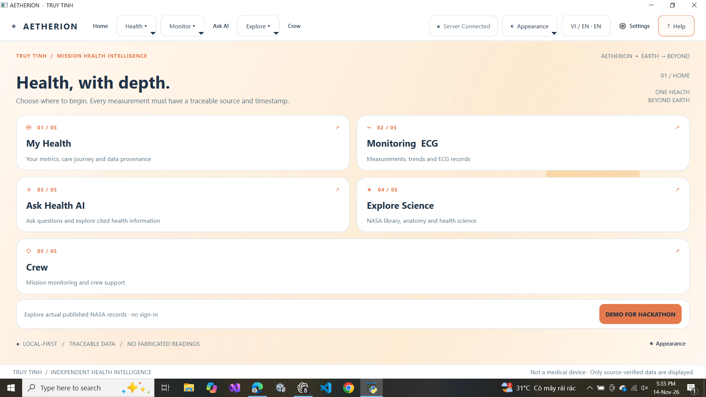

# AETHERION — NASA Space Apps 2026 challenge evidence

**Team:** TRUY TINH  
**Project:** AETHERION  
**Challenge:** [Create Health Monitoring Software for Astronauts on Space Missions](https://www.spaceappschallenge.org/2026/challenges/health-monitoring-software/)

AETHERION organizes the challenge experience around **GATHER → EVALUATE → ACT → RECHECK**. The links below take reviewers to the project materials, implementation records and desktop demonstration.

| Challenge experience | AETHERION contribution | Evidence in GitHub |
| --- | --- | --- |
| Gather health indicators | The server and SQLite store support source-linked, timestamped observations with units and quality metadata. | [Server entry point](../apps/server/src/aetherion_server/main.py) · [SQLite store](../apps/server/src/aetherion_server/store.py) · [API evidence](../docs/evidence/mobile-integration-api.json) |
| Evaluate health context | The desktop product brings mission overview, personal context, monitoring and source information into native workspaces. | [Desktop workspace](../apps/desktop/src/aetherion_desktop/mission_ops_home.py) · [Windows desktop capture](../docs/evidence/aetherion-desktop-portal-20261114.png) |
| Act and recheck | Care events and observations are organized for human-directed follow-up and persistence through the server data layer. | [Server store](../apps/server/src/aetherion_server/store.py) · [Integration record](../docs/MOBILE_DELIVERY_20261115.md) |
| Use NASA science in context | Published NASA challenge and research references are cataloged separately from individual crew observations. | [NASA source registry](../knowledge/nasa/source_registry.json) · [OSDR catalog](../knowledge/nasa/osdr_datasets.json) · [References](REFERENCES.md) |
| Run the desktop product | AETHERION is open on a Windows desktop in the owner-provided runtime capture; Portal/Home and the Demo entry are visible. | [1920×1080 desktop capture](../docs/evidence/aetherion-desktop-portal-20261114.png) · [Runtime evidence record](JUDGE_DEMO_PUBLICATION.md) |
| Review the project | The submission package includes the challenge response, bilingual presentation, AI disclosure, references and license notes. | [Challenge response](CHALLENGE_RESPONSE.md) · [Seven-slide presentation](JUDGE_DEMO_7_SLIDES.html) · [AI disclosure](AI_DISCLOSURE.md) · [Sources and licenses](SOURCES_AND_LICENSES.md) |

## Windows desktop demonstration

The project owner confirms that AETHERION launched successfully on the Windows desktop. This actual desktop capture shows the running AETHERION window on its Portal screen with the Demo entry visible.

The desktop capture is distinct from offscreen Qt images and is included as direct visual evidence of the application open on Windows.
