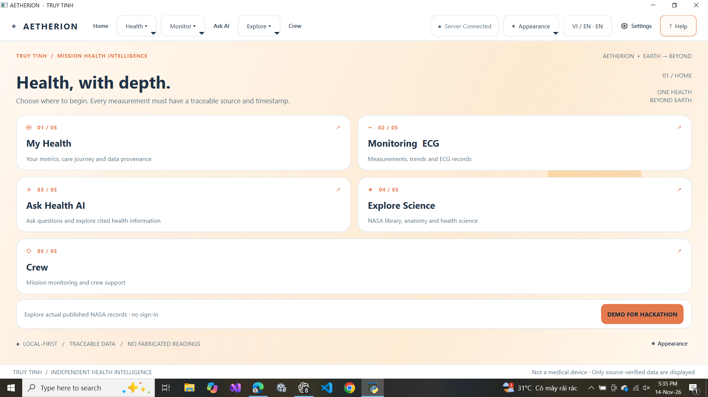

# AETHERION — NASA Space Apps 2026 Challenge Response (English)

**Team:** TRUY TINH  
**Project:** AETHERION  
**Challenge:** [Create Health Monitoring Software for Astronauts on Space Missions](https://www.spaceappschallenge.org/2026/challenges/health-monitoring-software/)  
**Repository Architecture:** Local-first Python FastAPI + SQLite server (`apps/server/src/aetherion_server/main.py`) paired with a native PySide6/Qt Windows desktop application (`apps/desktop/src/aetherion_desktop/main.py`).

---

## Desktop demonstration

The project owner confirms that AETHERION launched successfully on a Windows desktop. This actual desktop capture shows the native AETHERION window on the Portal screen, including the visible Demo entry.

## 1. Challenge Alignment: GATHER → EVALUATE → ACT → RECHECK

On long-duration missions beyond low Earth orbit, astronauts face five NASA Human Research Program (HRP) hazards—**space radiation, isolation and confinement, distance from Earth, altered gravity fields, and hostile closed environments**—while communication delays limit real-time ground flight-surgeon support. AETHERION structures astronaut health monitoring around a transparent, source-tracked four-stage loop:

1. **GATHER (Provenance-First Indicator Collection)**
   - Every observation in AETHERION is typed and bound to `subject_id`, `scope`, `metric`, `value`, `unit`, `observed_at`, `received_at`, `source_id`, `quality`, and `verification_state`.
   - Missing, stale, offline, denied, and unverified states (`NO_DATA`, `STALE`, `OFFLINE`, `DENIED`, `ERROR`, `UNVERIFIED`) are explicitly distinguished from healthy (`READY`) measurements. Silence or a missing sensor reading is **never** interpreted as unconsciousness or normal health.
   - **Implemented evidence:** SQLite observation persistence in `apps/server/src/aetherion_server/store.py` and server entrypoint in `apps/server/src/aetherion_server/main.py`.

2. **EVALUATE (Healthy-First Context & Scientific Traceability)**
   - A healthy crew member can inspect their `Today` / `Personal` status and `Mission Control` overview without being forced through a symptom-intake wizard.
   - Spaceflight hazard context is anchored to **verified NASA Open Science Data Repository (OSDR)** studies rather than fabricated vital signs. Our verified OSDR selection (`knowledge/nasa/osdr_datasets.json`) spans human longitudinal blood/serum/plasma cohorts (`OSD-575`, `OSD-569`, `OSD-530`), human iPSC-derived cardiomyocyte microgravity assays (`OSD-258`), and proton-irradiation neuro-epigenetic models (`OSD-374`), each carrying exact species, assay types, measurement units, DOIs, and license terms.
   - **Implemented evidence:** Official challenge capture (`knowledge/nasa/challenge_2026.json`) and verified OSDR catalog (`knowledge/nasa/osdr_datasets.json`).

3. **ACT (Human-in-the-Loop Agency & Offline Resilience)**
   - Deterministic safety rules and documented offline guidance operate independently of any optional AI gateway; if cloud or local AI is unavailable, core monitoring and human escalation workflows continue without degradation.
   - When an observation or user/witness report warrants attention, AETHERION supports structured incident logging and explicit human acknowledgement (`ACK`) rather than automated diagnosis or fictional emergency dispatch.

4. **RECHECK (Persisted Longitudinal Follow-Up)**
   - All observations, care events, and acknowledgements are persisted in SQLite across application restarts so crew members and flight surgeons (when telemetry syncs) can verify whether a trend resolved, persisted, or requires follow-up.

---

## 2. Science and product scope

AETHERION keeps source context, crew observations and demonstration data clearly distinguished:

- **NASA research context:** published NASA studies and datasets inform the scientific context; historical research is presented as research, separate from current crew observations.
- **Traceable observations:** records retain their subject, timestamp, unit, source, quality and verification state.
- **Human-directed care:** the product organizes source-linked context and follow-up so crew members can review and act; it does not present AI text as a verified clinical decision.
- **Independent project:** AETHERION is a TRUY TINH team prototype using public references; it is not a NASA product or endorsement.
