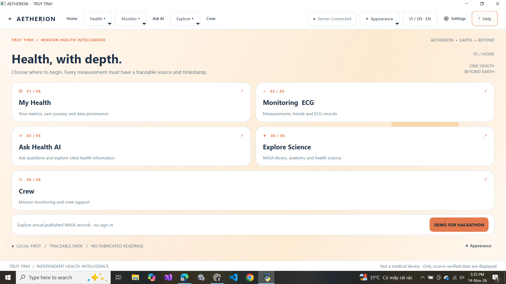

# AETHERION — Windows desktop evidence and judge demo

**Team:** TRUY TINH  
**Project:** AETHERION  
**Desktop capture:** 14 November 2026 · 1920×1080

## Windows desktop run

The project owner confirms that AETHERION launched successfully on the Windows desktop. The capture below shows the AETHERION application window open on its Portal screen, with the Demo entry visible.

- Evidence file: [aetherion-desktop-portal-20261114.png](../docs/evidence/aetherion-desktop-portal-20261114.png)
- Image size: 1920×1080 pixels
- SHA-256: `8473fde14e50750948177cae76e7dcf7dbde1a9aefa6463a0dc75d211ed5e2aa`

## Judge presentation

The repository includes a bilingual seven-slide presentation: [JUDGE_DEMO_7_SLIDES.html](JUDGE_DEMO_7_SLIDES.html). Slide 5 now includes the Windows desktop capture so viewers can see the running application interface in the presentation.

## Challenge workflow

AETHERION presents its astronaut-health concept through **GATHER → EVALUATE → ACT → RECHECK**. The presentation and [challenge response](CHALLENGE_RESPONSE.md) describe the product scope; the linked desktop capture documents the application visible on Windows.
