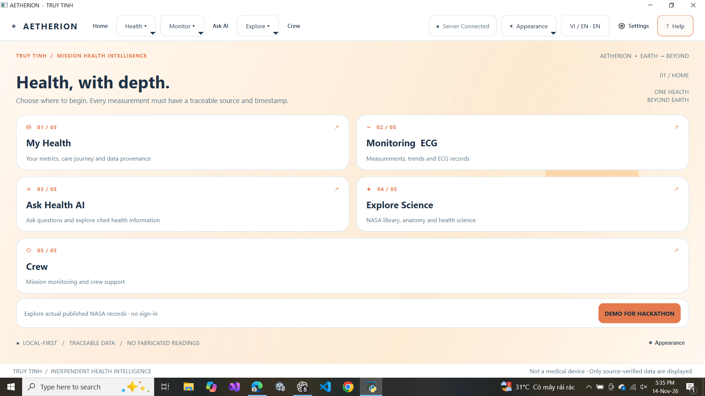

# NASA Space Apps Challenge 2026 — AETHERION

**Team:** TRUY TINH  
**Project:** AETHERION  
**Challenge:** [Create Health Monitoring Software for Astronauts on Space Missions](https://www.spaceappschallenge.org/2026/challenges/health-monitoring-software/)

## Project overview

AETHERION organizes health observations so a crew member can gather information, evaluate what is changing, choose a next action, and recheck later. The project is designed around **GATHER → EVALUATE → ACT → RECHECK**, with source-linked information and an offline-capable local server and native Windows desktop application.

## Desktop demonstration

The project owner confirms that AETHERION launched successfully on the Windows desktop. The actual 1920×1080 capture below shows the AETHERION window open on its Portal screen and the visible Demo entry.

[Open the full desktop capture](../docs/evidence/aetherion-desktop-portal-20261114.png) · [Desktop evidence record](JUDGE_DEMO_PUBLICATION.md)

## Judge materials

- [Challenge response](CHALLENGE_RESPONSE.md)
- [Seven-slide bilingual presentation](JUDGE_DEMO_7_SLIDES.html)
- [Claim-to-evidence map](CHALLENGE_EVIDENCE_MATRIX.md)
- [NASA references](REFERENCES.md)
- [AI use disclosure](AI_DISCLOSURE.md)
- [Sources and licenses](SOURCES_AND_LICENSES.md)
- [Desktop runtime evidence and demo record](JUDGE_DEMO_PUBLICATION.md)

This GitHub folder holds the project materials and runtime evidence. The team's official NASA Space Apps project entry is managed through the team page's Project tab.
